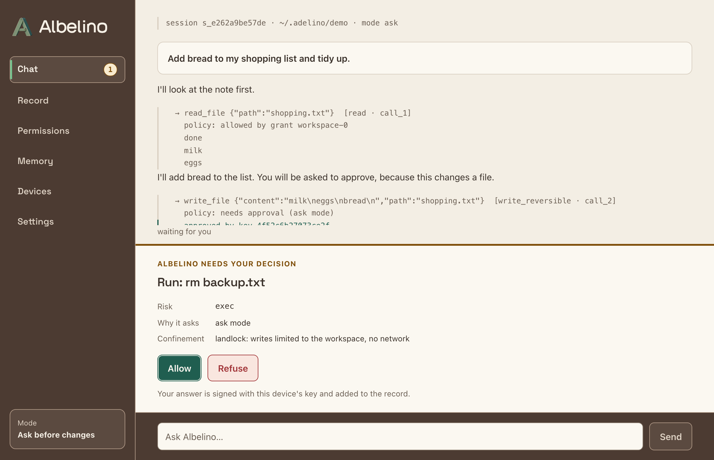

[Português](README.md) · [English](README.en.md) · [Español](README.es.md)

# Albelinostein

**The AI agent that can prove what it did.**

**Albelinostein** is the desktop and mobile app, and the name of its mascot.
Underneath runs **Adelino**, the engine and command-line program (`adelino`).

Adelino is a local AI agent: it runs on your computer, reads and writes
files, runs commands and calls services, like other agents. The difference
is what surrounds every action, so that afterwards it is possible to prove
what happened and who allowed it.

  

  

This repository is public so that people can find the product: what it is,
the state of each compiled version, how to verify a download, the user guide
and the whitepaper. The source code is not published yet.

Site: <https://albelino.plimswitzzer.com>

## The five guarantees

1. **A deterministic policy decides** whether an action may run. Never a
   second model.
2. **A human signature approves it** when it matters, from the terminal or
   from a paired phone that holds its own key.
3. **A signed, hash-chained ledger records everything.** Alter one byte
   later and `adelino verify` names the exact event.
4. **An OS sandbox confines commands.** An approved command still cannot
   write outside your project or reach the network.
5. **Undo** restores any file Adelino wrote.

It also has memory between sessions, a map of the working folder, and
*skills* made from books and documents the person provides. See the
[whitepaper](docs/whitepaper.en.md).

## State of the versions

Version 0.1.0 was published on 26 November 2026, **only on the downloads page
of the site**.

| System | State |
|---|---|
| Linux: `.deb`, `.rpm`, AppImage and command-line program | Validated by the acceptance suite; published |
| macOS | Not published: there is no Apple developer account yet (Developer ID and notarization) |
| Windows | Not published: there is no Windows code-signing certificate yet |
| Android | Published: APK (arm64) |
| iOS | Not published: there is no signed build recipe yet |

Every published file has its own signature file (`.asc`). The checksum list
and its signature are at <https://albelino.plimswitzzer.com/downloads/releases/0.1.0/SHA256SUMS>
and <https://albelino.plimswitzzer.com/downloads/releases/0.1.0/SHA256SUMS.asc>.

## Where the downloads are

- On the downloads page of the site: <https://albelino.plimswitzzer.com/en/downloads/>
- The **Releases** of this repository (GitHub) contain no release: the list
  is empty.

Published files. Linux (x86_64): `Albelino_0.1.0_x86_64.AppImage`,
`albelino_0.1.0_amd64.deb`, `albelino-0.1.0-1.x86_64.rpm` and the
command-line program `adelino-cli-0.1.0-x86_64-unknown-linux-gnu.tar.gz`.
Android (arm64): `Albelino_0.1.0_arm64-v8a.apk`.

This table and the downloads page are the source of truth: if there is no
version listed here, it does not exist.

## How a download is verified

1. Each version ships a `SHA256SUMS` file with the SHA-256 sum of every file.
2. `SHA256SUMS` is signed with the GPG key "Albelino Releases"; its public
   half is published in `docs/keys/albelino-releases.asc` (fingerprint in
   `docs/keys/albelino-releases.fingerprint`) and at
   <https://albelino.plimswitzzer.com/downloads/releases/public-key.asc>.
3. You check the signature of the list (`gpg --verify`), then the sum of
   the file (`sha256sum --check`).

Step by step: [docs/verify.en.md](docs/verify.en.md).

## Documentation

- [User guide](docs/guide.en.md) ([Português](docs/guia.pt.md), [Español](docs/guia.es.md))
- [Whitepaper](docs/whitepaper.en.md) ([Português](docs/whitepaper.pt.md), [Español](docs/whitepaper.es.md))
- [FAQ](docs/faq.en.md) ([Português](docs/faq.pt.md), [Español](docs/faq.es.md))
- [How to verify a download](docs/verify.en.md) ([Português](docs/verificar.pt.md), [Español](docs/verificar.es.md))
- [Security](SECURITY.md)
- [Changelog](CHANGELOG.md)

## Support

In the Discord community, where the team answers: <https://discord.gg/AyZHZPtkHk>. Questions in
#help, bugs in #bug-reports, ideas in #ideas.

Security vulnerabilities never on Discord: report them privately on GitHub,
under “Report a vulnerability” (<https://github.com/plimnew/Albelinostein/security/advisories/new>). See [SECURITY.md](SECURITY.md).

## Licence

The licence is Apache-2.0: Albelinostein can be used free of charge for any
purpose, including commercial use. The source code is not published yet.
The binaries are distributed by pLim.
