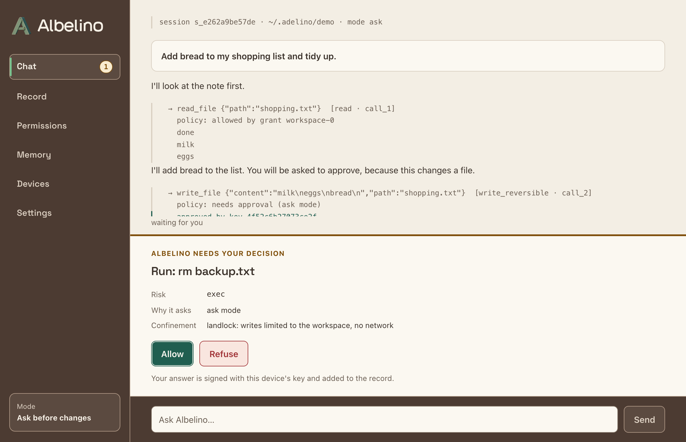

[Português](README.md) · [English](README.en.md) · [Español](README.es.md)

# Albelinostein

**El agente de IA que puede demostrar lo que hizo.**

**Albelinostein** es la aplicación para ordenador y móvil, y también el nombre de su mascota.
Por debajo funciona **Adelino**, el motor y el programa de línea de comandos (`adelino`).

Adelino es un agente de IA local: funciona en su ordenador, lee y escribe
archivos, ejecuta comandos y llama a servicios, como otros agentes. La diferencia
está en lo que rodea cada acción, para que después sea posible demostrar
qué ocurrió y quién lo autorizó.

  

  

Este repositorio es público para que se pueda encontrar el producto: qué es,
el estado de cada versión compilada, cómo verificar una descarga, la guía de uso
y el whitepaper. El código fuente no es público.

Sitio web: <https://albelino.plimswitzzer.com>

## Las cinco garantías

1. **Una política determinista decide** si una acción puede ejecutarse. Nunca un
   segundo modelo.
2. **Una firma humana la aprueba** cuando importa, desde el terminal o desde un
   móvil emparejado que guarda su propia clave.
3. **Un registro firmado y encadenado por hashes lo anota todo.** Si después se
   altera un solo byte, `adelino verify` señala el evento exacto.
4. **Un sandbox del sistema operativo confina los comandos.** Un comando aprobado
   sigue sin poder escribir fuera de su proyecto ni acceder a la red.
5. **Deshacer** restaura cualquier archivo que Adelino haya escrito.

También tiene memoria entre sesiones, un mapa de la carpeta de trabajo y
*skills* creadas a partir de libros y documentos que aporta la persona. Consulte
el [whitepaper](docs/whitepaper.en.md) (en inglés).

## Estado de las versiones

La versión 0.1.0 está en preparación. **No se ha publicado ninguna versión.**

| Sistema | Estado |
|---|---|
| Linux: `.deb`, `.rpm`, AppImage y programa de línea de comandos | Validado por las pruebas de aceptación; aún no publicado |
| macOS | Aún no validado |
| Windows | Aún no validado |
| Android | Aún no validado |
| iOS | Aún no validado |

Todavía no hay ningún archivo firmado y las claves de firma no se han generado.
Hoy no se puede descargar nada de este repositorio.

## Dónde aparecerán las descargas

- En las **Releases** de este repositorio (GitHub), cuando se publique una versión.
- En la página de descargas del sitio web: <https://albelino.plimswitzzer.com>

Esta tabla y la lista de Releases son la fuente de verdad: si una versión no
aparece aquí, no existe.

## Cómo se verifica una descarga

1. Cada versión incluye un archivo `SHA256SUMS` con la suma SHA-256 de cada archivo.
2. `SHA256SUMS` está firmado con la clave GPG "Albelino Releases"; su parte
   pública se publicará en `docs/keys/` con la primera versión.
3. Se comprueba la firma de la lista (`gpg --verify`) y después la suma del
   archivo (`sha256sum --check`).

Paso a paso: [docs/verificar.pt.md](docs/verificar.pt.md) (en portugués).

## Documentación

- [Guía de uso](docs/guide.en.md) (en inglés; [Português](docs/guia.pt.md))
- [Whitepaper](docs/whitepaper.en.md) (en inglés; [Português](docs/whitepaper.pt.md))
- [Preguntas frecuentes](docs/faq.pt.md) (en portugués)
- [Cómo verificar una descarga](docs/verificar.pt.md) (en portugués)
- [Seguridad](SECURITY.md)
- [Registro de cambios](CHANGELOG.md)

## Soporte

- **Comunidad en Discord**, para preguntas, errores e ideas: <https://discord.gg/AyZHZPtkHk>
- **Formulario**, para hablar directamente con pLimLab: <https://albelino.plimswitzzer.com/es/soporte/>

Las vulnerabilidades de seguridad, solo por el formulario y nunca en Discord: ver [SECURITY.md](SECURITY.md).

## Licencia

Binarios distribuidos por pLim. Todos los derechos reservados.
