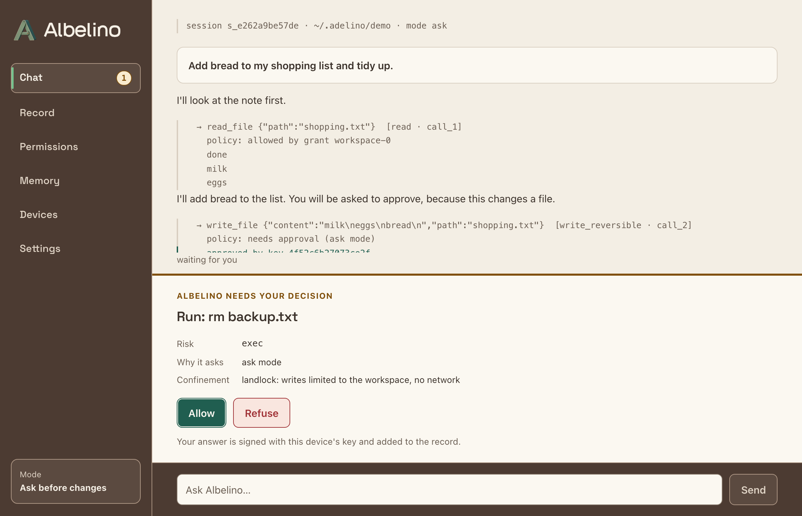

[Português](README.md) · [English](README.en.md) · [Español](README.es.md)

# Albelinostein

**O agente de IA que consegue provar o que fez.**

O **Albelinostein** é a aplicação para computador e telemóvel, e também o
nome da sua mascote. Por baixo corre o **Adelino**, o motor e o programa de
linha de comandos (`adelino`).

O Adelino é um agente de IA local: corre no seu computador, lê e escreve
ficheiros, executa comandos e chama serviços, como outros agentes. A
diferença é o que rodeia cada ação, para que, depois, seja possível provar o
que aconteceu e quem autorizou.

  

  

Este repositório é público e serve para encontrar o produto: o que é, o
estado de cada versão compilada, como verificar um download, o guia de
utilização e o documento técnico. O código-fonte não é público.

Site: <https://albelino.plimswitzzer.com>

## As cinco garantias

1. **Uma política determinística decide** se uma ação pode correr. Nunca um
   segundo modelo.
2. **Uma assinatura humana aprova** quando importa, no terminal ou num
   telemóvel emparelhado que tem a sua própria chave.
3. **Um registo assinado e encadeado por somas** guarda tudo. Se alterar um
   único byte mais tarde, `adelino verify` indica o evento exato.
4. **Uma sandbox do sistema operativo confina os comandos.** Um comando
   aprovado continua a não poder escrever fora do seu projeto nem usar a rede.
5. **Desfazer** repõe qualquer ficheiro que o Adelino tenha escrito.

Há ainda memória entre sessões, um mapa da pasta de trabalho e *skills*
criadas a partir de livros e documentos que a pessoa fornece. Ver o
[documento técnico](docs/whitepaper.pt.md).

## Estado das versões

A versão 0.1.0 está em preparação. **Não foi publicada nenhuma versão.**

| Sistema | Estado |
|---|---|
| Linux: `.deb`, `.rpm`, AppImage e programa de linha de comandos | Validado pelo guião de aceitação; ainda não publicado |
| macOS | Por validar |
| Windows | Por validar |
| Android | Por validar |
| iOS | Por validar |

Nenhum ficheiro está assinado e as chaves de assinatura ainda não foram
geradas. Nada pode ser descarregado a partir deste repositório hoje.

## Onde vão aparecer os downloads

- Nas **Releases** deste repositório (GitHub), quando existir uma versão publicada.
- Na página de downloads do site: <https://albelino.plimswitzzer.com>

Esta tabela e a lista de Releases são a fonte de verdade: se aqui não há
uma versão, ela não existe.

## Como se verifica um download

1. Cada versão traz um `SHA256SUMS` com a soma SHA-256 de cada ficheiro.
2. O `SHA256SUMS` é assinado com a chave GPG «Albelino Releases», cuja parte
   pública será publicada em `docs/keys/` com a primeira versão.
3. Confirma-se a assinatura da lista (`gpg --verify`) e depois a soma do
   ficheiro (`sha256sum --check`).

Passo a passo: [docs/verificar.pt.md](docs/verificar.pt.md).

## Documentação

- [Guia de utilização](docs/guia.pt.md) ([English](docs/guide.en.md))
- [Documento técnico](docs/whitepaper.pt.md) ([English](docs/whitepaper.en.md))
- [Perguntas frequentes](docs/faq.pt.md)
- [Como verificar um download](docs/verificar.pt.md)
- [Segurança](SECURITY.md)
- [Registo de alterações](CHANGELOG.md)

## Suporte

- **Comunidade no Discord**, para perguntas, erros e ideias: <https://discord.gg/AyZHZPtkHk>
- **Formulário**, para falar diretamente com a pLimLab: <https://albelino.plimswitzzer.com/suporte/>

Vulnerabilidades de segurança só pelo formulário, nunca no Discord: ver [SECURITY.md](SECURITY.md).

## Licença

Binários distribuídos pela pLim. Todos os direitos reservados.
