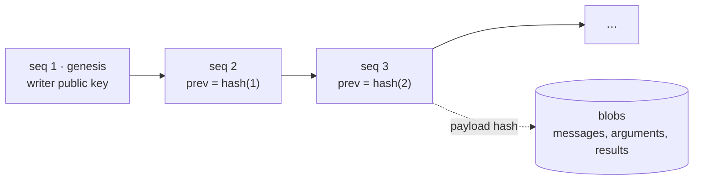
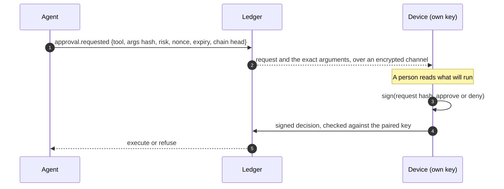

# Adelino: an AI agent whose actions can be proven

[Português](whitepaper.pt.md) · [English](whitepaper.en.md)

Version 0.1.0 is in preparation and has not been published. This document
describes the design of the engine (`adelino`) and the app (Albelinostein), and it
says where something is planned and not built. The source code is not public.

## 1. The problem

An AI agent reads files, runs commands and calls services on a person's
behalf. When something goes wrong, or when someone simply needs to know what
happened, the usual answer is a log. A log is a file written by the same
program that acted. It can be edited, it can be incomplete, and it proves
nothing to anyone who was not there.

Two further habits make this worse. Many agents run with broad autonomy by
default. Others ask a second model to judge whether an action is safe, but a
model can be talked into anything, and its verdict is neither readable nor
predictable.

Adelino starts from a different question: after the fact, can the person, or
a third party, show what the agent did, what allowed it, and who said yes?
Everything below follows from wanting that answer to be checkable, not
merely asserted.

## 2. Design principles

The project is governed by ten rules that every change must respect.

1. **No action without a record.** Intent is written to the ledger before a
   tool runs, the result after. State and its event commit together.
2. **No LLM decides what an LLM may do.** Permission decisions are
   deterministic code over declared risk, grants and taint.
3. **Irreversible means a human.** Nothing irreversible runs without a
   signed human decision, in any mode.
4. **The default is to ask.** A fresh install never acts on its own.
5. **Secrets stay out.** Keys are never written to the database, the ledger,
   a prompt, or a child process's environment.
6. **Local first.** Everything works with a local model and no network.
   Nothing leaves the machine unless the user chose a remote model or
   approved a request.
7. **Say what is not protected.** Every protection has a stated limit. Where
   a protection is unavailable, the product says so and falls back to
   asking.
8. **Borrow ideas, not code or names.**
9. **Small core.** New capabilities arrive as tools, tool servers or packs.
10. **No account, no problem.** Nothing that runs on the user's machine may
    require an account or contact a pLim server.

## 3. The ledger

Every event the agent produces is stored in an append-only ledger. The
ledger is the single source from which a session can be reproduced.

**Bytes.** Each event is serialised once. Those exact bytes are what is
stored, hashed and signed. Nothing is re-serialised during verification, so
there is no ambiguity about what was signed.

**Chain.** The hash of an event is `SHA-256("adelino.ledger.v1\0" ‖ bytes)`,
and every event names the hash of the one before it. SHA-256 was chosen
over a faster hash so that an auditor needs only standard tools.

**Signatures.** Each event is signed with Ed25519 by the device that wrote
it. The first event, the genesis, carries that device's public key.

**Payloads apart from the chain.** The chain holds hashes. Messages,
arguments and results live in a separate store and can be deleted
(`adelino redact`) without breaking verification. Privacy and integrity are
therefore not in conflict: the content can go, the proof that it existed and
was not altered stays.

**Append-only.** The application cannot update or delete ledger rows;
database triggers abort any such statement. Triggers can be removed by
someone with access to the database, which is why they are not the defence.
The defence is verification: in the project's own test, the trigger is
dropped, a recorded refusal is edited into an approval, and `adelino verify`
reports `FAIL at seq N: hash mismatch` at that exact event.

**Verify.** `adelino verify` walks the chain from the start. For each event
it checks that the bytes match the stored hash, that the sequence is
contiguous and links to the previous hash, that the writer signature is
valid, and, for approvals, that the signer was a paired and unrevoked device
and that the chain head it names is part of the chain. It stops at the first
failure and names the event.

**Replay.** A session can be rebuilt from the ledger alone, and it equals
what was shown live.

**Witness.** Another device can remember a past chain head and later check
that it is still part of the chain. This is the answer to the one thing an
internal chain cannot do alone: prove that it was not replaced wholesale.

**Export and outside verification.** `adelino export` writes a session to
one file holding the whole chain (hashes and metadata) plus the content of
that one session. `adelino verify --file` checks it on any machine with
Adelino installed, without the database or access to anything else. An edit
inside the file is detected.

**Key rotation.** The signing key can be replaced. The replacement is an
event signed by the key being retired. From then on only the new key may
write, and the old key can no longer approve. Earlier events stay
verifiable.

## 4. The policy

Permission is decided by a pure function over the request, the mode and the
grants. It performs no I/O and does not call a model.

**Risk classes.** Every tool call is classified as `read`,
`write_reversible`, `write_irreversible`, `network` or `exec`.

**Modes.** `ask` is the default: reads inside the working folder run and
everything else asks. `read_only` denies every mutation without asking.
`autonomous` runs only what a grant covers and asks about the rest.

**Grants.** A grant is issued by a human. It covers a path (read, or read and
write), a program, a host or a named tool. It can expire, can carry a use
budget, and can be revoked. A command grant can be limited to a prefix of
whole arguments, so `git status` can be granted without `git push`. Paths
are judged after symlinks are resolved, so a link cannot carry a write out
of a granted folder. Issuing and revoking a grant are ledger events.

**The taint rule.** Three conditions ask in every mode, whatever was granted:

- irreversible actions;
- network and command execution, once the session holds untrusted content
  (a web page, a file outside the working folder, the output of a tool
  server, the notes of a skill);
- any command when no OS sandbox is available.

The second is the important one. Untrusted text can contain instructions,
and a model may follow them. The policy does not try to recognise a hostile
instruction. It assumes that one may have arrived and removes the agent's
ability to act on the outside world without a person looking. No second
model decides anything.

## 5. Approvals and paired devices

When the policy answers "ask", the agent records an approval request. It
states the tool, the hash of the exact arguments, the risk class, the
session, a single-use nonce, an expiry and the chain head at that moment. A
decision is an Ed25519 signature over the hash of that request and the
decision, made by the approver's own key.

A decision is recorded only if the signature is valid, the approver is the
local device or a paired and unrevoked device, and the request is still
pending and not expired. A decision is single use. As a consequence:

- the host cannot turn a refusal into an approval, because it does not hold
  the phone's key;
- the host cannot move an approval onto different arguments;
- the host cannot rewrite earlier history and keep the approval valid,
  because the request names the old chain head;
- a device refuses to sign a request whose history is shorter than what it
  has already seen.

**Pairing.** The host shows a one-time link that holds its channel public
key and a code valid for five minutes. The device opens an encrypted channel
(Noise XK) and refuses a host that cannot prove the key from the link, then
presents the code and registers its own signing key. The key is recorded in
the ledger, so `verify` needs nothing but the ledger to show who approved
what. Revoking a device cuts it off at once, including a connection it
already has open.

A terminal approval follows the same path, with the local device key as the
approver. Pending approvals survive a restart or a crash; a command that was
running at the time of a crash is marked interrupted and is never run again
automatically.

## 6. The sandbox

An approval dialog is not a boundary: an approved command can do far more
than its name suggests. On Linux the operating system confines it.

- Commands are started directly from an argument list, never through a shell.
- Using Landlock, a command can write only inside the working folder, can read
  only the working folder and system directories, and has no TCP network.
- A command receives a short, allowlisted environment. Secrets in Adelino's
  environment do not reach it.
- A command dies when Adelino dies. At most 64 KiB per output stream is held
  and recorded; the rest is discarded and the result says so. A process left
  behind cannot keep the session waiting.
- If confinement cannot be applied, the command does not run "mostly"
  confined. The policy asks for every command and the ledger records
  `sandbox: none`.

On Windows and macOS there is no command sandbox yet. Every command asks
there, and the product says so.

## 7. Undo

Before `write_file` overwrites a file, it stores the previous content as a
blob, or marks the file as absent. The result event carries a reference to
it. `adelino undo <call>` restores the previous bytes, or deletes a file the
agent created, and records `undo.applied`. It refuses if the file was
changed after the agent wrote it, unless forced.

Only file writes can be undone. Commands and network requests cannot, which
is why they belong to riskier classes and ask more often.

## 8. Memory, the folder map and skills

**Facts.** The agent, or the person, can store a fact. It is usable in the
same session, is found by full-text search, and points at the ledger event
that created it. Storing one is a write and follows the policy. A person can
review and delete facts; removal is recorded.

**The folder map.** To let the agent ask how the files of a project connect,
instead of reading them one by one, Adelino can build a knowledge graph of
the working folder with a separate open-source tool, Graphify. The tool is
installed at a pinned version into Adelino's own directory, run offline with
model backends disabled and no query log, inside the same sandbox as any
other command, and its output is stored outside the project, which it does
not modify. After a file is written, the next question re-indexes first.

**Skills.** A person can give Adelino a book, article or manual they own
(PDF, EPUB, Word, HTML, Markdown or text). Adelino splits it into chapters
and has the model write notes chapter by chapter, which the agent can later
look up. Before anything is sent, it shows the number of chapters, the
number of calls, the expected tokens and the estimated cost, says that the
document goes to the model, and waits for agreement. Adelino reads only
files the person names; it never searches for or downloads books.

A skill is treated as hostile input because it is made of document text and
model output:

- a skill grants no permission and cannot skip an approval;
- the agent's standing instructions contain only what the person typed (name,
  file name, focus), never the notes;
- the agent reads the notes only through a tool that marks them as
  untrusted data, and after reading them the session is tainted, so
  commands and network requests ask whatever a grant says;
- the model is told that the chapter is data and that instructions in it are
  described, never followed;
- every model call made while distilling is recorded with its cost, is held
  to the spending limits, and notes already written are kept so a retry does
  not pay twice;
- adding, removing and switching a skill are ledger events, and adding
  records the SHA-256 of the source document.

The notes are written by a model and can be wrong. Nothing checks them
against the book.

## 9. Trust boundaries, and what Adelino does not protect against

| Boundary | Enforced by |
|---|---|
| Model output to action | The policy engine, never a model judging a model |
| Untrusted content to action | Taint: network and commands always ask afterwards |
| Tool server to action | Tools start as the riskiest class; a changed definition loses its trust; results taint the session |
| Command to filesystem | Landlock on Linux; elsewhere every command asks |
| Web view to engine | One command and three events; no network from the web view |
| Phone and host | Noise XK encryption; the pairing link carries the host key |
| History to auditor | Hash chain, writer signature, approver signatures |

Tools offered by external tool servers (MCP) are not confined by the
sandbox. They are gated instead: every new tool asks every time until the
person gives it a class, and a server that changes a tool's description or
inputs loses that trust.

What this does **not** do:

- It does not make a model's answers correct. The ledger proves what was
  said and done, not that it was true or wise.
- It does not stop a person from approving something harmful. An approval is
  a signature on exactly what was shown; reading it remains the person's job.
- A chain alone cannot prove it was not replaced as a whole. That needs a
  witness: a chain head held by another device.
- Redaction deletes content for good. The chain still verifies, but the text
  is gone.
- Where there is no sandbox (Windows, macOS) the only protection for commands
  is asking. The Linux sandbox does not yet restrict UDP or Unix sockets.
- Sending a prompt to a remote model sends it to that provider. Local first
  means a local model keeps everything on the machine; it is a choice, not a
  guarantee.
- A skill's notes can be wrong.
- A checklist in the engineering vertical records what the person declared;
  it does not make a flight safe or lawful.

## 10. Current state and limits

Version 0.1.0 is in preparation. No version has been published, no file is
signed, and the signing keys have not been generated.

- **Linux** (`.deb`, `.rpm`, AppImage and the command-line program) is
  validated by an acceptance suite that tests the files a person would
  download: integrity against checksums, the packages, the engine driven by
  scripted model answers (approve and refuse, undo, read-only mode,
  confinement, secrets, recovery after a kill, memory, export, tamper
  detection, spending limit, key rotation), and the app opened on a virtual
  display. Its limits: the app is exercised only through the guided tour, a
  real model is not used, installing with a package manager on a clean
  machine is not covered, and the folder map, paired phones and scheduled
  requests are not covered.
- **macOS, Windows, Android and iOS** are not yet validated. No signed app
  exists for iOS. Windows and macOS have no command sandbox.
- **Real models.** The model providers are tested at the protocol level
  against a stand-in server. Calls to a real model have not yet been
  verified, and skills have not been tried with a real book and a real model.
- **Not built yet:** sub-agents, sandboxing on Windows and macOS, background
  notifications on phones, scanning the pairing code with a phone camera, and
  the optional account service.

Support is available through the form at <https://albelino.plimswitzzer.com/suporte/> and in the
Discord community, <https://discord.gg/AyZHZPtkHk>.
