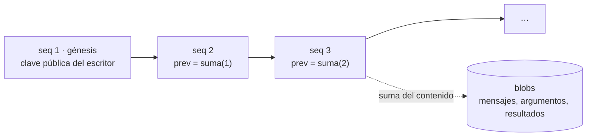
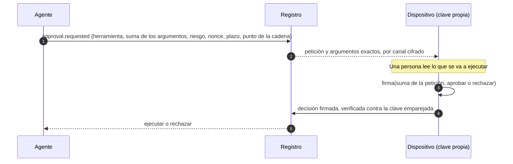

# Adelino: un agente de IA cuyas acciones se pueden demostrar

[Español](whitepaper.es.md) · [English](whitepaper.en.md)

La versión 0.1.0 se publicó el 26 de noviembre de 2026. Este documento
describe el diseño del motor (`adelino`) y de la aplicación (Albelinostein) e
indica dónde algo está planificado y no construido. El código fuente no es
público.

## 1. El problema

Un agente de IA lee archivos, ejecuta comandos y llama a servicios en nombre
de una persona. Cuando algo sale mal, o cuando alguien solo necesita saber
qué ocurrió, la respuesta habitual es un registro de texto. Ese registro es
un archivo escrito por el mismo programa que actuó. Puede editarse, puede
estar incompleto y no prueba nada a quien no estaba allí.

Hay dos hábitos que agravan el problema. Muchos agentes se ejecutan por
defecto con una autonomía amplia. Otros piden a un segundo modelo que juzgue
si una acción es segura, pero un modelo puede ser convencido de cualquier
cosa y su veredicto no es legible ni predecible.

Adelino parte de otra pregunta: una vez ocurrido, ¿puede la persona, o un
tercero, demostrar qué hizo el agente, qué lo permitió y quién dijo que sí?
Todo lo que sigue se deriva de querer que esa respuesta sea verificable, y no
solo afirmada.

## 2. Principios de diseño

El proyecto se rige por diez reglas que toda modificación debe respetar.

1. **Ninguna acción sin registro.** La intención se escribe en el registro
   antes de que se ejecute la herramienta, y el resultado después. El estado
   y su evento se guardan juntos.
2. **Ningún modelo decide lo que puede hacer otro modelo.** Las decisiones de
   permiso son código determinista sobre el riesgo declarado, las
   concesiones y la contaminación.
3. **Irreversible significa una persona.** Nada irreversible se ejecuta sin
   una decisión humana firmada, en cualquier modo.
4. **Por defecto, pregunta.** Una instalación nueva nunca actúa por su
   cuenta.
5. **Los secretos quedan fuera.** Las claves nunca se escriben en la base de
   datos, en el registro, en un prompt ni en el entorno de un proceso hijo.
6. **Primero lo local.** Todo funciona con un modelo local y sin red. Nada
   sale de la máquina, a no ser que la persona haya elegido un modelo remoto
   o autorizado una petición.
7. **Decir lo que no está protegido.** Cada protección tiene un límite
   declarado. Donde una protección no existe, el producto lo dice y vuelve a
   preguntar.
8. **Tomar ideas prestadas, no código ni nombres.**
9. **Núcleo pequeño.** Las nuevas capacidades llegan como herramientas,
   servidores de herramientas o packs.
10. **Sin cuenta, sin problema.** Nada de lo que se ejecuta en la máquina de
    la persona puede exigir una cuenta ni contactar con un servidor de pLim.

## 3. El registro

Cada evento que produce el agente queda en un registro de solo añadir
(ledger). Es la fuente única a partir de la cual se puede reproducir una
sesión.

**Bytes.** Cada evento se serializa una sola vez. Esos bytes exactos son los
que se guardan, se calculan y se firman. Nada se vuelve a serializar en la
verificación, por lo que no hay ambigüedad sobre lo que se firmó.

**Cadena.** La suma de un evento es `SHA-256("adelino.ledger.v1\0" ‖ bytes)`
y cada evento indica la suma del anterior. Se eligió SHA-256 en lugar de una
función más rápida para que un auditor solo necesite herramientas normales.

**Firmas.** Cada evento se firma con Ed25519 por el dispositivo que lo
escribió. El primer evento, el génesis, lleva la clave pública de ese
dispositivo.

**Contenido fuera de la cadena.** La cadena guarda sumas. Los mensajes, los
argumentos y los resultados quedan en un almacén aparte y se pueden borrar
(`adelino redact`) sin romper la verificación. Privacidad e integridad no
entran en conflicto: el contenido puede desaparecer, la prueba de que existió
y de que no fue alterado permanece.

**Solo de añadir.** La aplicación no puede modificar ni borrar filas del
registro; los disparadores de la base de datos abortan cualquier instrucción
de ese tipo. Quien tenga acceso a la base de datos puede quitar los
disparadores, y por eso no son ellos la defensa. La defensa es la
verificación: en la prueba del propio proyecto se quita el disparador, se
edita un rechazo registrado para convertirlo en una aprobación y
`adelino verify` indica `FAIL at seq N: hash mismatch` en ese evento exacto.

**Verificar.** `adelino verify` recorre la cadena desde el principio. En cada
evento comprueba que los bytes se corresponden con la suma guardada, que la
secuencia es contigua y enlaza con la suma anterior, que la firma del
escritor es válida y, en las aprobaciones, que quien firmó era un dispositivo
emparejado y no revocado y que el punto de la cadena que indica forma parte
de ella. Se detiene en el primer fallo y nombra el evento.

**Repetir.** Una sesión se reconstruye solo a partir del registro y es igual
a la que se mostró en directo.

**Testigo.** Otro dispositivo puede memorizar un punto pasado de la cadena y
verificar más tarde que sigue formando parte de ella. Es la respuesta a lo
que una cadena interna no puede probar por sí sola: que no ha sido sustituida
por completo.

**Exportar y verificar fuera.** `adelino export` escribe una sesión en un
solo archivo con toda la cadena (sumas y metadatos) y el contenido de esa
sesión. `adelino verify --file` lo verifica en cualquier máquina que tenga
Adelino instalado, sin la base de datos y sin acceso a nada más. Una edición
dentro del archivo se detecta.

**Cambio de clave.** La clave de firma puede sustituirse. El cambio es un
evento firmado por la clave que se retira. A partir de ahí solo la nueva
clave puede escribir y la antigua ya no puede aprobar. Los eventos anteriores
siguen siendo verificables.

## 4. La política

El permiso lo decide una función pura sobre la petición, el modo y las
concesiones. No hace entradas y salidas y no llama a ningún modelo.

**Clases de riesgo.** Cada llamada a una herramienta se clasifica como
`read`, `write_reversible`, `write_irreversible`, `network` o `exec`.

**Modos.** `ask` es el predeterminado: las lecturas dentro de la carpeta de
trabajo se ejecutan y todo lo demás pregunta. `read_only` rechaza toda
modificación sin preguntar. `autonomous` solo ejecuta lo que cubre una
concesión y pregunta el resto.

**Concesiones.** Una concesión la emite una persona. Cubre una ruta (lectura,
o lectura y escritura), un programa, un servidor o una herramienta con
nombre. Puede tener plazo y límite de usos, y puede revocarse. Una concesión
de comando puede limitarse a un prefijo de argumentos completos, para
permitir `git status` sin permitir `git push`. Las rutas se juzgan después de
resolver los enlaces simbólicos, por lo que un enlace no lleva una escritura
fuera de una carpeta concedida. Emitir y revocar concesiones son eventos del
registro.

**La regla de la contaminación.** Tres situaciones preguntan en cualquier
modo, con cualquier concesión:

- las acciones irreversibles;
- la red y la ejecución de comandos, una vez que la sesión tiene contenido
  externo no fiable (una página web, un archivo fuera de la carpeta de
  trabajo, el resultado de un servidor de herramientas, las notas de una
  skill);
- cualquier comando, cuando no hay sandbox del sistema operativo.

La segunda es la importante. Un texto no fiable puede contener instrucciones
y un modelo puede seguirlas. La política no intenta reconocer una
instrucción hostil. Presume que una puede haber llegado y le quita al agente
la capacidad de actuar en el exterior sin que una persona lo vea. Ningún
segundo modelo decide nada.

## 5. Aprobaciones y dispositivos emparejados

Cuando la política responde «pregunta», el agente registra una petición de
aprobación. Indica la herramienta, la suma de los argumentos exactos, la
clase de riesgo, la sesión, un número de un solo uso, un plazo y el punto de
la cadena en ese momento. Una decisión es una firma Ed25519 sobre la suma de
esa petición y la decisión, hecha con la clave del propio aprobador.

Una decisión solo se registra si la firma es válida, si el aprobador es el
dispositivo local o un dispositivo emparejado y no revocado, y si la
petición sigue pendiente y dentro del plazo. Cada decisión solo sirve una
vez. Consecuencias:

- el anfitrión no puede convertir un rechazo en una aprobación, porque no
  tiene la clave del móvil;
- no puede trasladar una aprobación a otros argumentos;
- no puede reescribir el historial anterior y mantener válida la aprobación,
  porque la petición indica el punto antiguo de la cadena;
- un dispositivo se niega a firmar una petición cuyo historial sea más corto
  que el que ya ha visto.

**Emparejamiento.** El anfitrión muestra un enlace de un solo uso que
contiene la clave pública de su canal y un código válido durante cinco
minutos. El dispositivo abre un canal cifrado (Noise XK), rechaza a un
anfitrión que no pueda demostrar la clave del enlace, presenta el código y
registra su clave de firma. Esa clave queda en el registro, por lo que
`verify` solo necesita el registro para mostrar quién aprobó qué. Revocar un
dispositivo le corta el acceso de inmediato, incluso en una conexión que ya
tenga abierta.

Una aprobación en el terminal sigue el mismo camino, con la clave del
dispositivo local como aprobador. Las aprobaciones pendientes sobreviven a un
reinicio o a un fallo; un comando que se estaba ejecutando en el momento del
fallo queda marcado como interrumpido y nunca vuelve a ejecutarse solo.

## 6. La sandbox

Un cuadro de diálogo de aprobación no es una frontera: un comando aprobado
puede hacer mucho más de lo que sugiere su nombre. En Linux, es el sistema
operativo el que lo confina.

- Los comandos arrancan directamente a partir de una lista de argumentos,
  nunca a través de una shell.
- Con Landlock, un comando solo puede escribir dentro de la carpeta de
  trabajo, solo puede leer la carpeta de trabajo y las carpetas del sistema,
  y no tiene red TCP.
- Un comando recibe un entorno corto y de lista permitida. Los secretos del
  entorno de Adelino no llegan allí.
- Un comando muere cuando muere Adelino. Como máximo se conservan y registran
  64 KiB por flujo de salida; el resto se descarta y el resultado lo dice.
  Un proceso que se quede atrás no puede dejar atascada la sesión.
- Si no se puede aplicar el confinamiento, el comando no se ejecuta «más o
  menos» confinado. La política pregunta por todos los comandos y el registro
  anota `sandbox: none`.

En Windows y macOS aún no hay sandbox de comandos. Allí todos los comandos
preguntan, y el producto lo dice.

## 7. Deshacer

Antes de que `write_file` sustituya un archivo, guarda el contenido anterior
como blob, o marca el archivo como inexistente. El evento de resultado lleva
una referencia a él. `adelino undo <llamada>` restaura los bytes anteriores,
o borra un archivo que el agente creó, y registra `undo.applied`. Se niega si
el archivo se modificó después de que el agente lo escribiera, a no ser que
se fuerce.

Solo las escrituras de archivos se deshacen. Los comandos y las peticiones de
red no, y por eso pertenecen a clases más arriesgadas y preguntan más veces.

## 8. Memoria, mapa de la carpeta y skills

**Hechos.** El agente, o la persona, puede guardar un hecho. Queda disponible
en la misma sesión, se encuentra por búsqueda de texto y apunta al evento del
registro que lo creó. Guardar uno es una escritura y sigue la política. La
persona puede revisar y borrar hechos; la eliminación queda registrada.

**El mapa de la carpeta.** Para que el agente pueda preguntar cómo se
relacionan los archivos de un proyecto, en lugar de leerlos uno a uno,
Adelino puede construir un grafo de conocimiento de la carpeta de trabajo con
una herramienta de código abierto aparte, Graphify. La herramienta se instala
en una versión fija en la carpeta propia de Adelino, se ejecuta sin conexión
con los modelos desactivados y sin registro de consultas, dentro de la misma
sandbox que cualquier otro comando, y el resultado queda fuera del proyecto,
que no se modifica. Después de que se escriba un archivo, la siguiente
pregunta vuelve a indexar primero.

**Skills.** La persona puede darle a Adelino un libro, artículo o manual que
le pertenezca (PDF, EPUB, Word, HTML, Markdown o texto). Adelino lo divide en
capítulos y hace que el modelo escriba notas capítulo a capítulo, que el
agente puede consultar más tarde. Antes de enviar nada, muestra el número de
capítulos, el número de llamadas, los tokens previstos y el coste estimado,
dice que el documento va al modelo y espera la conformidad. Adelino solo lee
archivos que la persona indique; nunca busca ni descarga libros.

Una skill se trata como entrada hostil, porque está hecha de texto de un
documento y de salida de un modelo:

- una skill no concede ningún permiso y no exime de ninguna aprobación;
- las instrucciones permanentes del agente contienen solo lo que la persona
  escribió (nombre, nombre del archivo, foco), nunca las notas;
- el agente solo lee las notas a través de una herramienta que las marca como
  datos no fiables, y después de leerlas la sesión queda contaminada, por lo
  que los comandos y las peticiones de red preguntan sea cual sea la
  concesión;
- se le dice al modelo que el capítulo son datos y que las instrucciones que
  contenga se describen, nunca se siguen;
- cada llamada al modelo hecha en la destilación queda registrada con el
  coste, está sujeta a los límites de gasto, y las notas ya escritas se
  guardan para que repetir no se pague dos veces;
- añadir, quitar y activar o desactivar una skill son eventos del registro, y
  al añadir se guarda el SHA-256 del documento de origen.

Las notas las escribe un modelo y pueden ser erróneas. Nada las contrasta con
el libro.

## 9. Fronteras de confianza y lo que Adelino no protege

| Frontera | Garantizada por |
|---|---|
| Salida del modelo hacia acción | El motor de política, nunca un modelo que juzga a otro |
| Contenido externo hacia acción | Contaminación: red y comandos preguntan siempre después |
| Servidor de herramientas hacia acción | Las herramientas empiezan en la clase más arriesgada; una definición alterada pierde la confianza; los resultados contaminan la sesión |
| Comando hacia sistema de archivos | Landlock en Linux; en los demás sistemas todos los comandos preguntan |
| Vista web hacia motor | Un comando y tres eventos; sin red en la vista web |
| Móvil y anfitrión | Cifrado Noise XK; el enlace de emparejamiento lleva la clave del anfitrión |
| Historial hacia auditor | Cadena de sumas, firma del escritor, firmas de los aprobadores |

Las herramientas ofrecidas por servidores de herramientas externos (MCP) no
las confina la sandbox. Se controlan de otra forma: cada herramienta nueva
pregunta siempre hasta que la persona le asigna una clase, y un servidor que
modifique la descripción o las entradas de una herramienta pierde esa
confianza.

Lo que esto **no** hace:

- No hace ciertas las respuestas de un modelo. El registro prueba lo que se
  dijo y se hizo, no que fuera verdad o sensato.
- No impide que una persona apruebe algo perjudicial. Una aprobación es una
  firma sobre exactamente lo que se mostró; leer sigue siendo tarea de la
  persona.
- Una cadena por sí sola no prueba que no haya sido sustituida por completo.
  Para eso hace falta un testigo: un punto de la cadena guardado por otro
  dispositivo.
- La eliminación de contenido lo borra para siempre. La cadena sigue
  verificándose, pero el texto ha desaparecido.
- Donde no hay sandbox (Windows, macOS), la única protección de los comandos
  es preguntar. La sandbox de Linux aún no restringe UDP ni sockets Unix.
- Enviar una petición a un modelo remoto la envía a ese proveedor. «Primero
  lo local» significa que un modelo local mantiene todo en la máquina; es una
  elección, no una garantía.
- Las notas de una skill pueden ser erróneas.
- Una lista de comprobación de la vertical de ingeniería registra lo que la
  persona declaró; no hace que un vuelo sea seguro ni legal.

## 10. Estado actual y límites

La versión 0.1.0 se publicó el 26 de noviembre de 2026, solo en la página de
descargas del sitio. Cada archivo publicado tiene su archivo de firma (`.asc`)
y la clave pública «Albelino Releases» está publicada. macOS, Windows e iOS
no están publicados.

- **Linux** (`.deb`, `.rpm`, AppImage y programa de línea de comandos) está
  validado por un guion de aceptación que prueba los archivos que una persona
  descargaría: integridad frente a las sumas, los paquetes, el motor
  conducido por respuestas de modelo guiadas (aprobar y rechazar, deshacer,
  modo de solo lectura, confinamiento, secretos, reanudación tras ser
  terminado, memoria, exportación, detección de manipulación, límite de
  gasto, cambio de clave) y la aplicación abierta en una pantalla virtual.
  Límites: la aplicación solo se ejercita con la visita guiada, no se usa un
  modelo real, no se cubre la instalación con el gestor de paquetes en una
  máquina limpia, y el mapa de la carpeta, los móviles emparejados y las
  peticiones programadas no están cubiertos.
- **macOS, Windows, Android e iOS** aún no están validados. Para iOS no
  existe una aplicación firmada. Windows y macOS no tienen sandbox de
  comandos.
- **Modelos reales.** Los proveedores de modelos se prueban a nivel de
  protocolo, contra un servidor de sustitución. Las llamadas a un modelo real
  aún no se han verificado, y las skills aún no se han probado con un libro y
  un modelo reales.
- **Aún no construido:** subagentes, sandbox en Windows y macOS,
  notificaciones en segundo plano en los móviles, lectura del código de
  emparejamiento con la cámara y el servicio de cuenta opcional.

El soporte se hace en la comunidad de Discord, <https://discord.gg/AyZHZPtkHk>.
Las vulnerabilidades de seguridad se comunican en privado en GitHub (consulta
[SECURITY.md](../SECURITY.md)).
