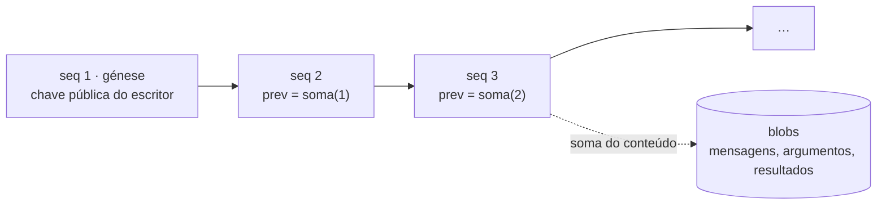
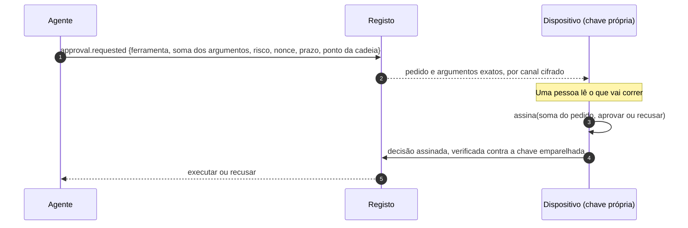

# Adelino: um agente de IA cujas ações se podem provar

[Português](whitepaper.pt.md) · [English](whitepaper.en.md)

A versão 0.1.0 está em preparação e não foi publicada. Este documento
descreve o desenho do motor (`adelino`) e da aplicação (Albelinostein) e diz onde
algo está planeado e não construído. O código-fonte não é público.

## 1. O problema

Um agente de IA lê ficheiros, executa comandos e chama serviços em nome de
uma pessoa. Quando algo corre mal, ou quando alguém só precisa de saber o
que aconteceu, a resposta habitual é um registo de texto. Esse registo é um
ficheiro escrito pelo mesmo programa que agiu. Pode ser editado, pode estar
incompleto e não prova nada a quem não estava lá.

Há dois hábitos que agravam o problema. Muitos agentes correm por omissão com
autonomia ampla. Outros pedem a um segundo modelo que julgue se uma ação é
segura, mas um modelo pode ser convencido de qualquer coisa e o seu veredicto
não é legível nem previsível.

O Adelino parte de outra pergunta: depois de acontecer, a pessoa, ou um
terceiro, consegue mostrar o que o agente fez, o que o permitiu e quem disse
que sim? Tudo o que se segue decorre de querer que essa resposta seja
verificável, e não apenas afirmada.

## 2. Princípios de desenho

O projeto rege-se por dez regras que toda a alteração tem de respeitar.

1. **Nenhuma ação sem registo.** A intenção é escrita no registo antes de a
   ferramenta correr, o resultado depois. O estado e o seu evento são
   gravados em conjunto.
2. **Nenhum modelo decide o que outro modelo pode fazer.** As decisões de
   permissão são código determinístico sobre o risco declarado, as
   concessões e a contaminação.
3. **Irreversível significa uma pessoa.** Nada de irreversível corre sem uma
   decisão humana assinada, em qualquer modo.
4. **Por omissão, pergunta.** Uma instalação nova nunca age sozinha.
5. **Os segredos ficam de fora.** As chaves nunca são escritas na base de
   dados, no registo, num prompt, nem no ambiente de um processo filho.
6. **Primeiro o local.** Tudo funciona com um modelo local e sem rede. Nada
   sai da máquina, a não ser que a pessoa tenha escolhido um modelo remoto ou
   autorizado um pedido.
7. **Dizer o que não está protegido.** Cada proteção tem um limite declarado.
   Onde uma proteção não existe, o produto di-lo e volta a perguntar.
8. **Tomar ideias emprestadas, não código nem nomes.**
9. **Núcleo pequeno.** As novas capacidades chegam como ferramentas,
   servidores de ferramentas ou packs.
10. **Sem conta, sem problema.** Nada do que corre na máquina da pessoa pode
    exigir uma conta nem contactar um servidor da pLim.

## 3. O registo

Cada evento que o agente produz fica num registo só de acrescentar (ledger).
É a fonte única a partir da qual uma sessão se pode reproduzir.

**Bytes.** Cada evento é serializado uma só vez. Esses bytes exatos são os
que se guardam, se calculam e se assinam. Nada é serializado de novo na
verificação, por isso não há ambiguidade sobre o que foi assinado.

**Cadeia.** A soma de um evento é `SHA-256("adelino.ledger.v1\0" ‖ bytes)` e
cada evento indica a soma do anterior. Escolheu-se o SHA-256 em vez de uma
função mais rápida para que um auditor precise apenas de ferramentas
normais.

**Assinaturas.** Cada evento é assinado com Ed25519 pelo dispositivo que o
escreveu. O primeiro evento, a génese, traz a chave pública desse
dispositivo.

**Conteúdo fora da cadeia.** A cadeia guarda somas. As mensagens, os
argumentos e os resultados ficam num armazém à parte e podem ser apagados
(`adelino redact`) sem quebrar a verificação. Privacidade e integridade não
entram em conflito: o conteúdo pode desaparecer, a prova de que existiu e de
que não foi alterado fica.

**Só de acrescentar.** A aplicação não consegue alterar nem apagar linhas do
registo; gatilhos da base de dados abortam qualquer instrução desse tipo.
Quem tiver acesso à base de dados pode remover os gatilhos, e por isso não
são eles a defesa. A defesa é a verificação: no teste do próprio projeto o
gatilho é removido, uma recusa registada é editada para uma aprovação e o
`adelino verify` indica `FAIL at seq N: hash mismatch` nesse evento exato.

**Verificar.** O `adelino verify` percorre a cadeia desde o início. Em cada
evento confirma que os bytes correspondem à soma guardada, que a sequência é
contígua e liga à soma anterior, que a assinatura do escritor é válida e,
nas aprovações, que quem assinou era um dispositivo emparelhado e não
revogado e que o ponto da cadeia que indica faz parte dela. Pára na primeira
falha e nomeia o evento.

**Repetir.** Uma sessão reconstrói-se só a partir do registo e é igual ao
que foi mostrado em direto.

**Testemunha.** Outro dispositivo pode memorizar um ponto passado da cadeia
e verificar mais tarde que continua a fazer parte dela. É a resposta ao que
uma cadeia interna não consegue provar sozinha: que não foi substituída por
inteiro.

**Exportar e verificar fora.** O `adelino export` escreve uma sessão num só
ficheiro com toda a cadeia (somas e metadados) e o conteúdo dessa sessão. O
`adelino verify --file` verifica-o em qualquer máquina com o Adelino
instalado, sem a base de dados e sem acesso a mais nada. Uma edição dentro
do ficheiro é detetada.

**Troca de chave.** A chave de assinatura pode ser substituída. A troca é um
evento assinado pela chave que se reforma. Daí em diante só a nova chave
pode escrever e a antiga já não pode aprovar. Os eventos anteriores
continuam verificáveis.

## 4. A política

A permissão é decidida por uma função pura sobre o pedido, o modo e as
concessões. Não faz entradas e saídas e não chama nenhum modelo.

**Classes de risco.** Cada chamada a uma ferramenta é classificada como
`read`, `write_reversible`, `write_irreversible`, `network` ou `exec`.

**Modos.** `ask` é o predefinido: as leituras dentro da pasta de trabalho
correm e tudo o resto pergunta. `read_only` recusa toda a alteração sem
perguntar. `autonomous` só executa o que uma concessão cobre e pergunta o
resto.

**Concessões.** Uma concessão é emitida por uma pessoa. Cobre um caminho
(leitura, ou leitura e escrita), um programa, um servidor ou uma ferramenta
com nome. Pode ter prazo e limite de usos, e pode ser revogada. Uma
concessão de comando pode limitar-se a um prefixo de argumentos inteiros,
para permitir `git status` sem permitir `git push`. Os caminhos são julgados
depois de resolvidas as ligações simbólicas, por isso uma ligação não leva
uma escrita para fora de uma pasta concedida. Emitir e revogar concessões
são eventos do registo.

**A regra da contaminação.** Três situações perguntam em qualquer modo, com
qualquer concessão:

- as ações irreversíveis;
- a rede e a execução de comandos, depois de a sessão ter conteúdo de fora
  de confiança (uma página web, um ficheiro fora da pasta de trabalho, o
  resultado de um servidor de ferramentas, as notas de uma skill);
- qualquer comando, quando não há sandbox do sistema operativo.

A segunda é a importante. Um texto não fiável pode conter instruções e um
modelo pode segui-las. A política não tenta reconhecer uma instrução hostil.
Presume que uma pode ter chegado e retira ao agente a capacidade de agir no
exterior sem que uma pessoa veja. Nenhum segundo modelo decide nada.

## 5. Aprovações e dispositivos emparelhados

Quando a política responde «pergunta», o agente regista um pedido de
aprovação. Indica a ferramenta, a soma dos argumentos exatos, a classe de
risco, a sessão, um número de uso único, um prazo e o ponto da cadeia nesse
momento. Uma decisão é uma assinatura Ed25519 sobre a soma desse pedido e a
decisão, feita pela chave do próprio aprovador.

Uma decisão só é registada se a assinatura for válida, se o aprovador for o
dispositivo local ou um dispositivo emparelhado e não revogado, e se o pedido
ainda estiver pendente e dentro do prazo. Cada decisão só serve uma vez.
Consequências:

- o anfitrião não consegue transformar uma recusa numa aprovação, porque não
  tem a chave do telemóvel;
- não consegue mover uma aprovação para outros argumentos;
- não consegue reescrever o histórico anterior e manter a aprovação válida,
  porque o pedido indica o ponto antigo da cadeia;
- um dispositivo recusa-se a assinar um pedido cujo histórico seja mais curto
  do que o que já viu.

**Emparelhamento.** O anfitrião mostra uma ligação de uso único que contém a
chave pública do seu canal e um código válido por cinco minutos. O
dispositivo abre um canal cifrado (Noise XK), recusa um anfitrião que não
consiga provar a chave da ligação, apresenta o código e regista a sua chave
de assinatura. Essa chave fica no registo, por isso o `verify` só precisa do
registo para mostrar quem aprovou o quê. Revogar um dispositivo corta-lhe o
acesso de imediato, mesmo numa ligação que já tenha aberta.

Uma aprovação no terminal segue o mesmo caminho, com a chave do dispositivo
local como aprovador. As aprovações pendentes sobrevivem a um reinício ou a
uma falha; um comando que corria no momento da falha fica marcado como
interrompido e nunca volta a correr sozinho.

## 6. A sandbox

Uma caixa de diálogo de aprovação não é uma fronteira: um comando aprovado
pode fazer muito mais do que o nome sugere. No Linux, é o sistema operativo
que o confina.

- Os comandos arrancam diretamente a partir de uma lista de argumentos,
  nunca através de uma shell.
- Com o Landlock, um comando só pode escrever dentro da pasta de trabalho,
  só pode ler a pasta de trabalho e as pastas do sistema, e não tem rede TCP.
- Um comando recebe um ambiente curto e de lista permitida. Os segredos do
  ambiente do Adelino não chegam lá.
- Um comando morre quando o Adelino morre. No máximo 64 KiB por fluxo de
  saída são mantidos e registados; o resto é descartado e o resultado di-lo.
  Um processo deixado para trás não consegue prender a sessão.
- Se o confinamento não puder ser aplicado, o comando não corre «mais ou
  menos» confinado. A política pergunta por todos os comandos e o registo
  grava `sandbox: none`.

No Windows e no macOS ainda não há sandbox de comandos. Aí todos os comandos
perguntam, e o produto di-lo.

## 7. Desfazer

Antes de o `write_file` substituir um ficheiro, guarda o conteúdo anterior
como blob, ou marca o ficheiro como inexistente. O evento de resultado leva
uma referência para ele. O `adelino undo <chamada>` repõe os bytes
anteriores, ou apaga um ficheiro que o agente criou, e regista
`undo.applied`. Recusa se o ficheiro foi alterado depois de o agente o
escrever, a não ser que se force.

Só as escritas de ficheiros se desfazem. Os comandos e os pedidos de rede
não, e por isso pertencem a classes mais arriscadas e perguntam mais vezes.

## 8. Memória, mapa da pasta e skills

**Factos.** O agente, ou a pessoa, pode guardar um facto. Fica disponível
na mesma sessão, encontra-se por pesquisa de texto e aponta para o evento do
registo que o criou. Guardar um é uma escrita e segue a política. A pessoa
pode rever e apagar factos; a remoção fica registada.

**O mapa da pasta.** Para que o agente possa perguntar como os ficheiros de
um projeto se ligam, em vez de os ler um a um, o Adelino pode construir um
grafo de conhecimento da pasta de trabalho com uma ferramenta de código
aberto à parte, o Graphify. A ferramenta é instalada numa versão fixa na
pasta própria do Adelino, corre offline com os modelos desligados e sem
registo de consultas, dentro da mesma sandbox de qualquer outro comando, e o
resultado fica fora do projeto, que não é alterado. Depois de um ficheiro
ser escrito, a pergunta seguinte volta a indexar primeiro.

**Skills.** A pessoa pode dar ao Adelino um livro, artigo ou manual que lhe
pertença (PDF, EPUB, Word, HTML, Markdown ou texto). O Adelino divide-o em
capítulos e faz o modelo escrever notas capítulo a capítulo, que o agente
pode consultar mais tarde. Antes de enviar seja o que for, mostra o número
de capítulos, o número de chamadas, os tokens previstos e o custo estimado,
diz que o documento segue para o modelo e espera pela concordância. O
Adelino só lê ficheiros que a pessoa indicar; nunca procura nem descarrega
livros.

Uma skill é tratada como entrada hostil, porque é feita de texto de um
documento e de saída de um modelo:

- uma skill não dá permissão nenhuma e não dispensa nenhuma aprovação;
- as instruções permanentes do agente contêm só o que a pessoa escreveu
  (nome, nome do ficheiro, foco), nunca as notas;
- o agente só lê as notas através de uma ferramenta que as marca como dados
  não fiáveis, e depois de as ler a sessão fica contaminada, pelo que
  comandos e pedidos de rede perguntam seja qual for a concessão;
- diz-se ao modelo que o capítulo são dados e que as instruções que contenha
  são descritas, nunca seguidas;
- cada chamada ao modelo feita na destilação fica registada com o custo,
  está sujeita aos limites de gasto, e as notas já escritas são guardadas
  para que repetir não se pague duas vezes;
- juntar, remover e ligar ou desligar uma skill são eventos do registo, e
  juntar grava o SHA-256 do documento de origem.

As notas são escritas por um modelo e podem estar erradas. Nada as confronta
com o livro.

## 9. Fronteiras de confiança e o que o Adelino não protege

| Fronteira | Garantida por |
|---|---|
| Saída do modelo para ação | O motor de política, nunca um modelo a julgar outro |
| Conteúdo de fora para ação | Contaminação: rede e comandos perguntam sempre depois |
| Servidor de ferramentas para ação | As ferramentas começam na classe mais arriscada; uma definição alterada perde a confiança; os resultados contaminam a sessão |
| Comando para sistema de ficheiros | Landlock no Linux; nos outros sistemas todos os comandos perguntam |
| Vista web para motor | Um comando e três eventos; sem rede na vista web |
| Telemóvel e anfitrião | Cifra Noise XK; a ligação de emparelhamento leva a chave do anfitrião |
| Histórico para auditor | Cadeia de somas, assinatura do escritor, assinaturas dos aprovadores |

As ferramentas oferecidas por servidores de ferramentas externos (MCP) não
são confinadas pela sandbox. São controladas de outra forma: cada ferramenta
nova pergunta sempre até a pessoa lhe dar uma classe, e um servidor que
altere a descrição ou as entradas de uma ferramenta perde essa confiança.

O que isto **não** faz:

- Não torna certas as respostas de um modelo. O registo prova o que foi dito
  e feito, não que fosse verdade ou sensato.
- Não impede uma pessoa de aprovar algo prejudicial. Uma aprovação é uma
  assinatura sobre exatamente o que foi mostrado; ler continua a ser tarefa
  da pessoa.
- Uma cadeia sozinha não prova que não foi substituída por inteiro. Para
  isso é preciso uma testemunha: um ponto da cadeia guardado por outro
  dispositivo.
- A remoção de conteúdo apaga-o de vez. A cadeia continua a verificar, mas o
  texto desapareceu.
- Onde não há sandbox (Windows, macOS), a única proteção dos comandos é
  perguntar. A sandbox do Linux ainda não restringe UDP nem sockets Unix.
- Enviar um pedido a um modelo remoto envia-o a esse fornecedor. «Primeiro o
  local» significa que um modelo local mantém tudo na máquina; é uma
  escolha, não uma garantia.
- As notas de uma skill podem estar erradas.
- Uma lista de verificação da vertical de engenharia regista o que a pessoa
  declarou; não torna um voo seguro nem legal.

## 10. Estado atual e limites

A versão 0.1.0 está em preparação. Não foi publicada nenhuma versão, nenhum
ficheiro está assinado e as chaves de assinatura ainda não foram geradas.

- O **Linux** (`.deb`, `.rpm`, AppImage e programa de linha de comandos) está
  validado por um guião de aceitação que testa os ficheiros que uma pessoa
  descarregaria: integridade face às somas, os pacotes, o motor conduzido
  por respostas de modelo guiadas (aprovar e recusar, desfazer, modo só de
  leitura, confinamento, segredos, retoma depois de ser morto, memória,
  exportação, deteção de adulteração, limite de gasto, troca de chave) e a
  aplicação aberta num ecrã virtual. Limites: a aplicação só é exercitada
  pela visita guiada, não se usa um modelo verdadeiro, não se cobre a
  instalação com o gestor de pacotes numa máquina limpa, e o mapa da pasta,
  os telemóveis emparelhados e os pedidos agendados não estão cobertos.
- **macOS, Windows, Android e iOS** ainda não estão validados. Para iOS não
  existe aplicação assinada. O Windows e o macOS não têm sandbox de comandos.
- **Modelos verdadeiros.** Os fornecedores de modelos são testados ao nível
  do protocolo, contra um servidor de substituição. As chamadas a um modelo
  verdadeiro ainda não foram verificadas, e as skills ainda não foram
  experimentadas com um livro e um modelo verdadeiros.
- **Ainda não construído:** subagentes, sandbox no Windows e no macOS,
  notificações em segundo plano nos telemóveis, leitura do código de
  emparelhamento com a câmara e o serviço de conta opcional.

O suporte faz-se pelo formulário em <https://albelino.plimswitzzer.com/suporte/> e na
comunidade do Discord, <https://discord.gg/AyZHZPtkHk>.
